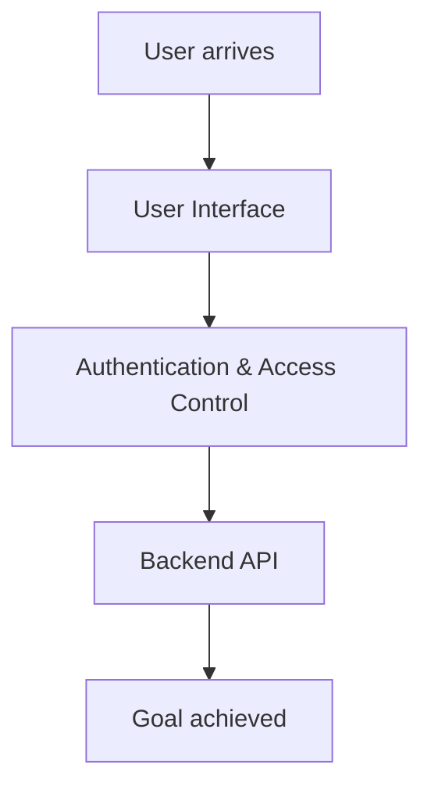

# Business Flow — Lets create login page with username and password and on  sucess hello world sta

## Overview

Predicted 6 deliverable(s) [new_project] for: 'Lets create login page with username and password and on  sucess hello world static page display'. Active needs: user_interaction, authentication.

This is the business/domain view: the flows the system supports across its features, independent of any technology choice.

## Flows

### User Interface
Users interact through screens/forms, so a UI is required. (driven by: user_interaction)

### Authentication & Access Control
Users must be identified/logged in, so email + password sign-in is required. (driven by: authentication)

### Backend API
Data must be created/read/updated, so a backend API is required. (driven by: authentication)

## Journey

