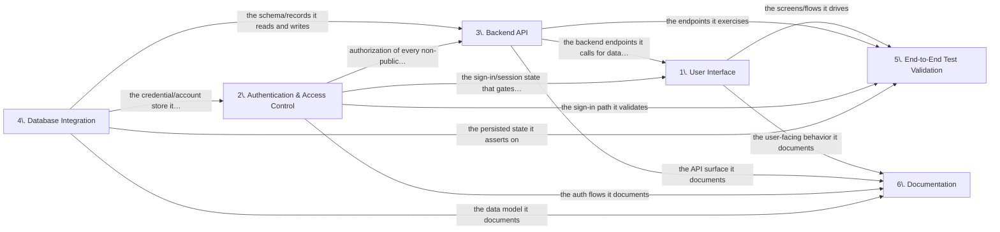

# Architecture — Lets create login page with username and password and on sucess hello world stat

## Overview

Technical architecture on a **recommended** stack (model-selected; not yet confirmed): TypeScript, Next.js, PostgreSQL, Prisma, Auth.js, Playwright. Confirm it or adjust via feedback before build.

Cross-feature dependencies are called out below so each feature is implemented against the contracts it relies on.

## Components

- **1. User Interface** (ui): front-end (components, forms, routing) — recommended TypeScript, Next.js.
- **2. Authentication & Access Control** (auth): auth service + session/identity store — recommended TypeScript, Next.js, Auth.js.
- **3. Backend API** (api): back-end API (controllers, services, repositories) — recommended TypeScript, Next.js.
- **4. Database Integration** (database): data store (schema, migrations) — recommended TypeScript, PostgreSQL, Prisma.
- **5. End-to-End Test Validation** (e2e_tests): end-to-end test suite — recommended TypeScript, Playwright.
- **6. Documentation** (documentation): project documentation.

## Data flow

## Cross-feature dependencies

- **User Interface** depends on:
    - **Backend API** (api) — the backend endpoints it calls for data + actions.
    - **Authentication & Access Control** (auth) — the sign-in/session state that gates protected screens.
- **Authentication & Access Control** depends on:
    - **Database Integration** (database) — the credential/account store it verifies against.
- **Backend API** depends on:
    - **Database Integration** (database) — the schema/records it reads and writes.
    - **Authentication & Access Control** (auth) — authorization of every non-public endpoint.
- **End-to-End Test Validation** depends on:
    - **User Interface** (ui) — the screens/flows it drives.
    - **Backend API** (api) — the endpoints it exercises.
    - **Authentication & Access Control** (auth) — the sign-in path it validates.
    - **Database Integration** (database) — the persisted state it asserts on.
- **Documentation** depends on:
    - **User Interface** (ui) — the user-facing behavior it documents.
    - **Backend API** (api) — the API surface it documents.
    - **Authentication & Access Control** (auth) — the auth flows it documents.
    - **Database Integration** (database) — the data model it documents.
